<picture>
  <source media="(prefers-color-scheme: dark)" srcset="assets/header-dark.svg">
  
</picture>

I work as a growth cofounder and fractional head of growth for a small number of companies in Egypt, the GCC and MENA. I also build my own products. I'm the founder of **Read to Lead**, which makes growth systems, books and SaaS tools for founders and marketers.

<p dir="rtl">بشتغل Growth Cofounder و Fractional Head of Growth لعدد محدود من الشركات في مصر والخليج، وببني منتجاتي الخاصة. مؤسس <b>Read to Lead</b>.</p>

### Open source

**[Growth Marketing OS](https://github.com/growthack88/growth-marketing-os)** is my public library of AI marketing assets: prompts, Claude skills, agents, playbooks and sourced benchmarks in English and Arabic. The original assets come from work on real accounts and are MIT-licensed.

The newest addition is the **MENA Ads Command Center**, a paid-ads skill for the Arab world. It covers audits, media plans, Arabic ad copy by dialect, delivered-order ROAS for cash-on-delivery stores, and Ramadan planning. Install it in Claude Code:

```
/plugin marketplace add growthack88/growth-marketing-os
/plugin install mena-ads@growth-marketing-os
```

### What I'm building

| Product | What it is |
|---|---|
| **[StartupKit Pro](https://startupkit.pro)** | Founder OS for MENA startups: 67 connected tools in Arabic and English that turn your answers into a pitch deck, financial model and investor pack. |
| **[Growth OS](https://growthduckup.com)** | One workspace with 17 focused tools for growth marketers. |
| **[DuckDoro](https://duckdoro.com)** | A calm daily planner: three priorities, one frog, one focus session. |

Most product code lives in private repos. The parts I can share go into Growth Marketing OS.

### Teaching and writing

- **[Growth Hack Academy](https://www.youtube.com/@GrowthHackAcademy)**: 128+ free Arabic videos on growth hacking, media buying and e-commerce. There's also a [course site](https://growthhackacademy.com).
- **[Building Growth Machine (ماكينة النمو)](https://buildinggrowthmachine.com)**: a practical guide to 10 growth machines that work together for compounding growth.

### How I work

- **Systems over campaigns.** A campaign ends; a growth machine compounds.
- **Numbers with sources.** I'd rather say "I don't know yet" than quote a made-up benchmark.
- **Arabic-first, not translated.** MENA audiences can tell the difference.

### Elsewhere

[mahmoudomar.com](https://mahmoudomar.com) · [LinkedIn](https://www.linkedin.com/in/growthack88/) · [X](https://x.com/growthack88) · [YouTube](https://www.youtube.com/@GrowthHackAcademy)
